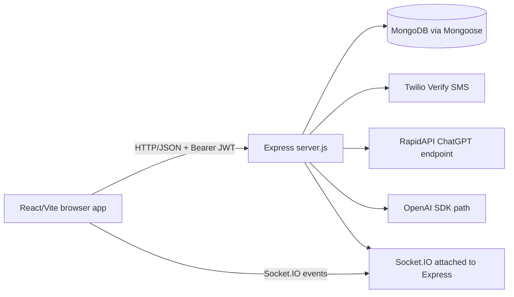
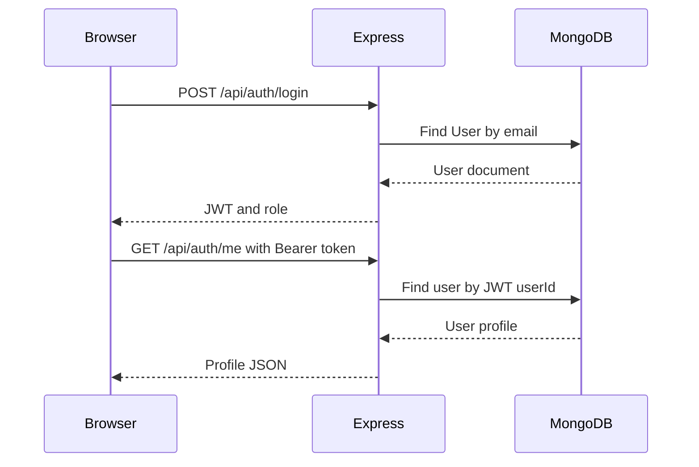

# Hope-I Mental Health Assistant

Hope-I is a React and Express web application for mental-wellness support. It provides a public landing page, an authenticated user dashboard, an AI chat experience, appointment booking with doctors, doctor/admin dashboards, and real-time user-doctor messaging.

> **Implementation note:** This document describes the code currently in this repository. Several areas are unfinished or inconsistent (for example, two chat designs coexist, the frontend API URL is hard-coded, and the deployed backend requires environment variables). They are listed as limitations rather than presented as completed features.

## Problem and objectives

The application is intended to give a user a simple place to:

- ask an AI assistant for general, category-aware guidance;
- request an appointment with an available doctor;
- communicate with a doctor through a Socket.IO room;
- use guided exercise and moral-support pages; and
- allow administrators to view users and doctors.

It is a student full-stack project, not a medical diagnosis or emergency-response system.


## 🔑 Demo Credentials

### Patient
- **Email:** `anjali.mehta@example.com`
- **Password:** `user123`

### Doctor
- **Email:** `priya.sharma@medcare.com`
- **Password:** `doctor123`

### Admin
- **Email:** `ravi.verma@adminpanel.com`
- **Password:** `vadmin123`


## Features actually represented in code

- React/Vite single-page UI with routes in `frontend/src/App.jsx`.
- Email/password login in `frontend/src/pages/Login.jsx` and `backend/routes/auth.js`.
- Twilio Verify OTP request/verification endpoints.
- JWT creation and Bearer-token middleware.
- MongoDB/Mongoose models for users, OTP records, chats, messages, appointments, and browser permissions.
- User, doctor, and admin dashboard screens.
- Doctor listing and appointment booking.
- Socket.IO room messaging, with messages persisted by `backend/server.js`.
- AI bot endpoint using the RapidAPI controller in `backend/controllers/botController.js`.
- A separate OpenAI chat-room implementation in `backend/routes/chats.js`.
- Tailwind CSS, Framer Motion, and React Icons UI styling.
- Render deployment configuration.

## Architecture



The production entry point is `backend/server.js`. `backend/src/app.js` is a second, incomplete Express setup and is not imported by `server.js`. The frontend starts in `frontend/src/main.jsx`, renders `App`, and uses React Router routes.

## Folder structure

```text
hope-i-main/
├── frontend/
│   ├── public/                 Static images and browser assets
│   ├── src/
│   │   ├── components/         Navbar, ChatRoom, auth/permission UI
│   │   ├── contexts/            AuthContext
│   │   ├── config/              API and Socket.IO clients
│   │   ├── hooks/               useChat
│   │   ├── pages/               Public, login, bot, exercise pages
│   │   └── Dashboards/          User, Doctor, Admin screens
│   ├── package.json             Vite scripts and browser dependencies
│   ├── vite.config.js           Vite configuration
│   ├── tailwind.config.js       Tailwind content configuration
│   └── build.sh                 Render-style frontend build script
├── backend/
│   ├── server.js                Active HTTP, Socket.IO, routes, MongoDB startup
│   ├── routes/                  Express route modules
│   ├── controllers/             AI bot and chat controller logic
│   ├── middleware/auth.js       JWT verification middleware
│   ├── models/                  Mongoose schemas
│   ├── utils/twilio.js          Twilio Verify helper functions
│   ├── src/app.js               Alternate, currently unused app setup
│   ├── package.json              Backend dependencies and start scripts
│   └── build.sh                 Render dependency installation script
├── render.yaml                  Render service and environment declarations
└── package.json                 Root dependency file (Axios only; no scripts)
```

## Technology stack

| Area | Technology | Use in this project |
|---|---|---|
| UI | React 18 | Components, state, effects, and page rendering |
| Build | Vite | Dev server and production bundle |
| Routing | React Router 6 | Browser routes in `App.jsx` |
| Styling | Tailwind CSS | Utility classes throughout JSX |
| Animation/icons | Framer Motion, React Icons | Dashboard and landing-page presentation |
| API client | Axios and `fetch` | REST calls from frontend |
| Server | Node.js and Express | REST API and middleware |
| Persistence | MongoDB and Mongoose | Schemas and database operations |
| Auth | JSON Web Tokens | Bearer-token authentication |
| OTP | Twilio Verify | SMS verification |
| Real time | Socket.IO | Room joins and message events |
| AI | RapidAPI ChatGPT endpoint; OpenAI SDK path | Bot responses in two different implementations |
| Deployment | Render | Declared web service in `render.yaml` |

## Application workflow

1. `frontend/src/main.jsx` mounts `App`.
2. `App` displays an eight-second splash screen, then creates a `BrowserRouter`.
3. Public routes render `Home`, `About`, login, permission, exercise, moral, or chatbot pages.
4. Login posts email/password to `/api/auth/login`; a successful JWT is stored in `localStorage`.
5. The role in the response chooses `/user`, `/doctor`, or `/admin`.
6. Dashboards call `/api/auth/me` and other protected endpoints with `Authorization: Bearer <token>`.
7. `server.js` applies CORS/body parsing, mounts route modules, connects to MongoDB, and starts HTTP plus Socket.IO.
8. Appointment and profile data are read from Mongoose models.
9. User-doctor messaging joins a Socket.IO room, saves a `Message`, and emits `receive_message`.



## API reference

The active server mounts these prefixes:

| Method | Endpoint | Auth | Purpose |
|---|---|---:|---|
| POST | `/api/auth/request-otp` | No | Send Twilio Verify SMS |
| POST | `/api/auth/verify-otp` | No | Verify OTP and save verification record |
| POST | `/api/auth/register` | No | Create a user and return JWT |
| POST | `/api/auth/login` | No | Email/password login and JWT |
| GET | `/api/auth/me` | Token checked inside route | Return current profile |
| POST | `/api/auth/reset-password` | No | Reset password after stored OTP verification |
| POST | `/api/bot/chat` | Yes | RapidAPI-backed category-aware bot response |
| GET | `/api/bot/test` | Yes | Test both RapidAPI bot variants |
| GET | `/api/doctors/available` | Yes | List doctor IDs |
| GET | `/api/doctors/:doctorId` | Yes | Return doctor details |
| GET | `/api/appointments/my` | Yes | Current user's appointments |
| POST | `/api/appointments/book` | Yes | Create an appointment |
| GET | `/api/appointments/doctor` | Yes | Appointments for current doctor |
| GET | `/api/appointments/doctor/summary` | Yes | Compact doctor appointment list |
| GET | `/api/admin/users` | Admin | List users |
| GET | `/api/admin/doctors` | Admin | List doctors |
| GET | `/api/admin/chats` | Admin | Query chats |
| GET | `/api/admin/chats/sensitive` | Admin | Query sensitive embedded messages |
| POST | `/api/permissions/request` | Yes | Save browser permission state |
| GET | `/api/permissions/status` | Yes | Read permission state |
| GET | `/api/messages/:room` | No | Read room messages |
| POST | `/api/messages` | No | Save a room message |

The alternate `/api/chats` routes in `routes/chats.js` and `controllers/chatController.js` expect a different `Chat` schema and refer to `req.user`/`req.io` that the active server does not establish. Treat that path as incomplete until reconciled.

## Database design

Mongoose models are:

- **User:** string `userId`, name, unique email and phone number, password, role, OTP fields, lock/activity metadata, and timestamps. The schema currently restricts `role` to `user`, which conflicts with admin/doctor route queries.
- **OTP:** phone number, OTP, verification flag, expiry, and TTL index.
- **Appointment:** string user/doctor IDs, slot, and creation time.
- **Message:** room, sender ID/type, message text, and timestamp.
- **Chat:** ObjectId participants and embedded messages for the alternate chat design.
- **Permission:** user ID, microphone/camera/location flags, location coordinates, and timestamps.

## Installation and running

Prerequisites: Node.js, MongoDB, and the credentials required by the backend.

```bash
cd backend
npm install
npm start

# In a second terminal
cd frontend
npm install
npm run dev
```

The frontend currently uses `https://hope-i-bot.onrender.com/api` in `frontend/src/config/api.js`, so local development requires changing configuration or providing a compatible backend URL.

Expected backend variables include:

```env
PORT=5002
MONGODB_URI=mongodb://localhost:27017/hope-ai
JWT_SECRET=replace-me
JWT_EXPIRES_IN=24h
TWILIO_ACCOUNT_SID=replace-me
TWILIO_AUTH_TOKEN=replace-me
TWILIO_VERIFY_SID=replace-me
TWILIO_PHONE_NUMBER=replace-me
OPENAI_API_KEY=replace-me
```

`render.yaml` also declares `NODE_ENV`, `VITE_API_URL`, and external credentials. Do not commit real values.

## Security and limitations

Implemented: JWT verification middleware, CORS allow-list, Twilio verification, MongoDB persistence, and role checks in admin routes.

Important weaknesses to fix before production:

1. `backend/routes/auth.js` stores and compares passwords as plain text; use `bcryptjs` hashing and `bcrypt.compare`.
2. `backend/controllers/botController.js` contains a hard-coded RapidAPI key; rotate it and use an environment variable.
3. `server.js` logs request bodies and the JWT secret; remove sensitive logging.
4. Several routes lack authentication (`/api/messages`), validation, rate limiting, and ownership checks.
5. `User` only permits role `user`, while admin/doctor behavior assumes other roles.
6. `auth.js` places `req.role` but some chat code expects `req.user`, and some socket/chat paths are not wired.
7. CORS and API URLs are inconsistent between source, `render.yaml`, and the README.
8. Permission collection stores precise location data; obtain informed consent and minimize retention.

## Testing status

No test suite is present in the repository. The frontend build/lint scripts exist, but dependencies were not installed in the inspected workspace, so validation could not run here. Backend startup likewise stopped at the missing `dotenv` dependency.

## Further reading

- [PROJECT_WORKFLOW.md](./PROJECT_WORKFLOW.md) contains the detailed file map, data flows, and interview-oriented architecture explanation.
- [INTERVIEW_PREPARATION.md](./INTERVIEW_PREPARATION.md) contains project-specific questions and concise answers.
